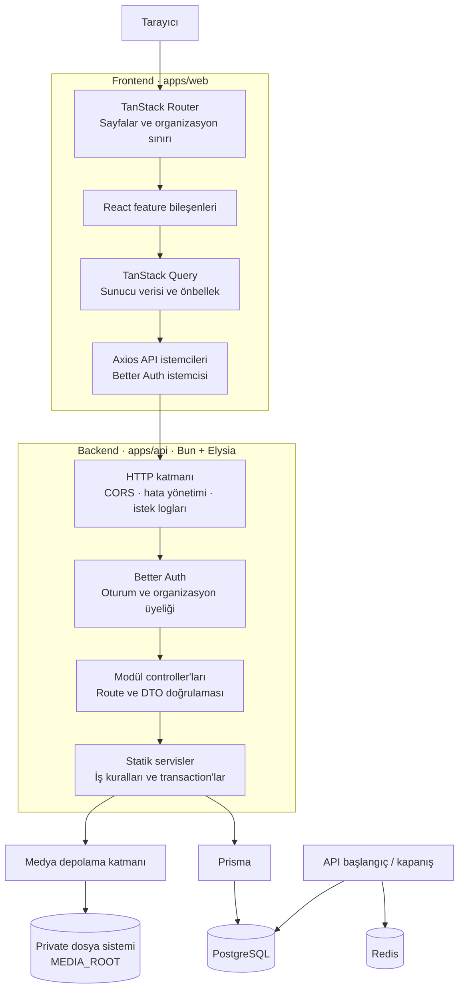
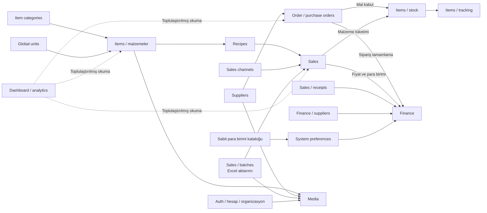
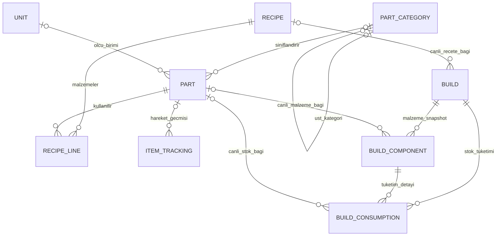
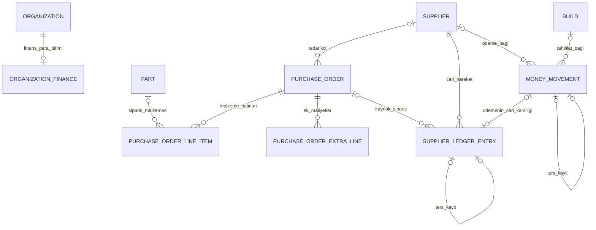

# Projenin mimari raporu

## Kapsam

Proje, organizasyon bazlı çalışan; malzeme, reçete, stok, satın alma, satış ve finans süreçlerini birleştiren bir ERP uygulamasıdır. Backend tarafında mikroservisler yerine tek API içinde ayrılmış modüller bulunur.

Bu rapor mevcut kaynak kod, Prisma şeması ve migration dosyalarından çıkarılmıştır. **“Veritabanında var” ifadeleri kaynakta tanımlı yapıları anlatır; canlı veritabanındaki tabloların ve uygulanmış migration’ların envanteri değildir.**

Diyagramlar Mermaid biçimindedir. Mermaid destekleyen bir Markdown görüntüleyicisinde çizim olarak görüntülenebilir.

---

## 1. Genel sistem mimarisi

### Kullanılan temel teknolojiler

| Katman | Mevcut teknoloji |
|---|---|
| Monorepo / paket yönetimi | Bun workspaces, Turborepo |
| Frontend | React 19, TypeScript, Vite |
| Yönlendirme / veri | TanStack Router, TanStack Query, Axios |
| Arayüz | Tailwind CSS, Radix tabanlı bileşenler |
| Dashboard düzenleyici | SnapGrid |
| Backend | Bun, Elysia **1.4.30** |
| Kimlik ve organizasyon | Better Auth **1.7.7** |
| Veritabanı erişimi | Prisma 7, PostgreSQL adapter |
| Veritabanı | PostgreSQL; geliştirme compose dosyasında PostgreSQL 17 |
| Dosya saklama | Private yerel dosya sistemi; metadata PostgreSQL’de |

**Redis ile ilgili önemli ayrım:** Mevcut kaynakta Redis bağlantısı ve başlangıç kontrolü vardır; ancak iş verisi cache’i, kuyruk, pub/sub veya session store olarak kullanıldığına rastlanmamıştır. API başlangıcı yine de Redis bağlantısının başarılı olmasını bekler.

Kaynaklar: [API bileşimi](../apps/api/src/app.ts#L27), [başlangıç akışı](../apps/api/src/index.ts#L42), [frontend başlangıcı](../apps/web/src/main.tsx#L19), [API bağımlılıkları](../apps/api/package.json#L21).

---

## 2. Backend modülleri nasıl bağlı?

Modüller HTTP üzerinden birbirleriyle konuşan ayrı servisler değildir. **Aynı süreç içinde birbirlerinin servis metotlarını çağırır ve gerektiğinde aynı veritabanı transaction’ını paylaşırlar.**

Oklar, servis veya veri bağımlılığını; kesikli oklar raporlama amaçlı okumayı gösterir.

### Modül envanteri

| Modül | Sorumluluğu | Alt modüller / önemli bağlantılar |
|---|---|---|
| `auth` | Giriş, oturum, native organizasyon ve takım altyapısı | Better Auth; `auth` ve `tenant` kontrolleri |
| `users` | Kullanıcı okuma, hesap yönetimi, üyelik ekleme ve rol değişikliği | Better Auth native API’leri, avatar medyası |
| `dashboard` | Sistem/kişisel özetler ve kişisel pano | `layout`, `analytics` |
| `supplier` | Tedarikçi kayıtları | `images`; satın alma ve finans bağlantıları |
| `item-categories` | Hiyerarşik malzeme kategorileri | Kategori ağacı ve item bağlantıları |
| `items` | Fiziksel malzemeler ve mevcut stok | `images`, `stock`, `tracking` |
| `units` | Platform genelindeki ölçü birimleri | Item’lar tarafından kullanılır |
| `currencies` | Sunucunun sabit ISO para birimi kataloğu | Ayrı Currency tablosu yoktur |
| `system-preferences` | Sistem varsayılan para birimi | Satın alma ve organizasyon finansı |
| `recipes` | Reçeteler, malzeme miktarları ve satış fiyatı | Items, units, finance |
| `order` | Satın alma süreçleri | `purchase-orders` → `lines`, `extra-lines`, `receive` |
| `sales` | Reçete üzerinden satış kaydı | `channels`, `receipts`, `batches` |
| `finance` | Kasa hareketleri ve tedarikçi carisi | `suppliers`; satış tahsilatı ve satın alma borcu |
| `media` | Yükleme, dosya erişimi, bağlama ve silme yaşam döngüsü | Logo, avatar, item/tedarikçi görseli, satış Excel’i |

### Bir modülün iç yapısı

- **`controller.ts`:** HTTP route’u, doğrulama, kimlik/tenant gereksinimi ve durum kodları.
- **`service.ts`:** İş kuralları, veri erişimi ve transaction’lar.
- **`model.ts`:** DTO şemaları ve bunlardan türetilmiş tipler.
- **`formatter.ts`:** Gerektiğinde tarih, Decimal ve yanıt serileştirmesi.

Alt controller’lar üst modülde `.use(...)` ile birleştirilir; `app.ts` üst modülleri kaydeder.

Kaynaklar: [app.ts](../apps/api/src/app.ts#L48), [sales bileşimi](../apps/api/src/modules/sales/controller.ts#L9), [finance bileşimi](../apps/api/src/modules/finance/controller.ts#L7).

---

## 3. Veritabanında neler tanımlı?

Prisma şemasında **47 model ve 47 açık tablo eşlemesi** bulunur.

İsimlendirmede iki kritik nokta vardır:

- **`Part` / `part` = uygulamadaki Item, yani fiziksel malzeme.**
- **`Build` / `build` = uygulamadaki kaydedilmiş satış.**

Dolayısıyla `Build` ismi, ayrı bir üretim emri/BOM sistemi olduğu anlamına gelmez.

### Tam tablo envanteri

Aşağıdaki isimler fiziksel tablo adlarıdır.

| Alan | Tablolar | Saklanan veri |
|---|---|---|
| Kimlik ve oturum | `user`, `session`, `account`, `verification` | Hesap, giriş bilgileri, oturum ve doğrulama kayıtları |
| Organizasyon | `organization`, `member`, `invitation`, `team`, `team_member` | Organizasyonlar, üyelikler, native roller, takımlar |
| Profil ve sorumluluk | `owner`, `user_profile` | İş sorumlusu metadata’sı ve organizasyon kapsamlı profil yapısı |
| Kişisel pano | `dashboard` | Kullanıcıya özel global/organizasyon pano düzeni |
| Global katalog/ayar | `model_type`, `unit`, `system_preference` | İçerik türleri, ölçü birimleri, sistem varsayılanı |
| Malzeme ve stok | `part_category`, `part`, `item_tracking` | Kategori ağacı, malzeme, stok bakiyesi ve hareket geçmişi |
| Reçete | `recipe`, `recipe_line` | Reçete, satış fiyatı ve bir adet için malzeme miktarları |
| Tedarik ve satın alma | `supplier`, `purchase_order`, `purchase_order_line_item`, `purchase_order_extra_line` | Tedarikçi, sipariş, malzeme satırları ve ek maliyetler |
| Satış | `build`, `build_component`, `build_consumption` | Satış, satış anındaki malzeme görüntüsü ve stok tüketimi |
| Satış kanalı / Excel aktarımı | `sales_channel`, `sales_channel_mapping`, `sales_batch`, `sales_batch_channel`, `sales_product_mapping` | Kanallar, dosyalar ve dış verinin kanal/reçete eşlemeleri |
| Finans | `organization_finance`, `money_movement`, `supplier_ledger_entry` | Organizasyon para birimi, kasa hareketleri, tedarikçi carisi |
| Medya | `media_file` | Dosya metadata’sı, sahibi, bağlantısı ve yaşam döngüsü |
| Etiket ve seçim listeleri | `tag`, `tagged_item`, `selection_list`, `selection_list_entry` | Genel yardımcı yapılar |
| Not ve ekler | `note`, `notes_image`, `attachment` | Genel notlar, görseller ve dosya referansları |
| Bildirim / webhook | `notification_entry`, `notification_message`, `webhook_endpoint`, `webhook_message` | Bildirim ve webhook veri yapıları |

**Şema ile aktif özellik aynı şey değildir:** Kod taramasında `UserProfile`, `ModelType`, etiket/seçim listesi, not/ek, bildirim ve webhook modellerinin aktif API tüketicileri bulunmamıştır. Bunlar çalışan özellikler değil, **şemada bulunan fakat mevcut uygulama akışında kullanılmıyor görünen yapılar** olarak değerlendirilmelidir. Bu gözlem canlı DB’de kayıt bulunmadığı veya dış tüketici olmadığı anlamına gelmez. `Owner` ise satın alma sorumlusu çözümlemesinde kullanılır.

Kaynak: [Prisma şeması](../apps/api/prisma/schema.prisma#L18).

### Kimlik ve veri kapsamı

- Better Auth’un **9 native modeli** string kimlik kullanır.
- Kalan **38 model**, içeride integer `id`, dışarıya açılan kaynak kimliği olarak benzersiz `uuid` taşır.
- İş verisinin ana kapsamı `organizationId` alanıdır.
- `Unit`, `SystemPreference`, `ModelType` globaldir.
- `Dashboard.organizationId = null`, kullanıcının global kişisel panosu anlamına gelir.
- Medyada nullable organizasyon alanı; geçici yükleme, avatar ve silme yaşam döngüsünün bir parçasıdır.

---

## 4. Ana veritabanı ilişkileri

### 4.1 Malzeme, reçete ve satış

ER diyagramlarında daire, ilişkinin isteğe bağlı olabildiğini gösterir. Okunabilirlik için her tablonun organizasyon ve kullanıcı bağlantısı tekrarlanmamıştır. Gösterilen ilişkiler ana ilişkilerin bir alt kümesidir.

Bu yapının önemli sonuçları:

- **Ayrı stok kalemi tablosu yoktur.** Mevcut bakiye `Part.stock` alanındadır.
- Stok `Decimal(20,5)` tipindedir; HTTP’de tam ondalık dize olarak taşınır.
- `ItemTracking`, hareketin önceki/sonraki bakiyesini ve ilgili açıklamaları tutar.
- `RecipeLine.quantity`, **bir adet reçete satışı** için tüketilecek malzeme miktarıdır.
- Satışta reçete adı, sürümü, fiyatı ve malzemeleri snapshot olarak kaydedilir.
- Canlı reçete veya malzeme bağlantısı silinse bile satışın kaydedilmiş isim/UUID/miktar bilgileri korunabilir.

**Örnek:** Bir reçete bir porsiyon için `0.200 kg` malzeme gerektiriyorsa, 3 adet satış toplam `0.600 kg` stok tüketir.

Mevcut şemada depo, raf, lot, seri numarası veya ayrı son kullanma partisi modeli bulunmaz.

Kaynaklar: [malzeme ve stok](../apps/api/prisma/schema.prisma#L400), [reçete](../apps/api/prisma/schema.prisma#L442), [satış snapshot’ları](../apps/api/prisma/schema.prisma#L622).

### 4.2 Satın alma ve finans

Burada **iki ayrı bakiye** vardır:

- **Kasa bakiyesi:** `MoneyMovement.amount` toplamı. Pozitif giriş, negatif çıkış.
- **Tedarikçi carisi:** `SupplierLedgerEntry.amount` toplamı. Pozitif borcu artırır; negatif ödeme/avans borcu azaltır.

Bakiye, sürekli güncellenen ayrı bir para alanı olarak değil, **kaydedilmiş hareketlerin toplamı** olarak hesaplanır. Finansal düzeltme, orijinal kaydı silmek yerine ters işaretli bağlı kayıtla yapılır.

**Ayrı `Receipt` tablosu yoktur:** Satış tahsilatı, satışa bağlı bir `MoneyMovement` kaydıdır.

Kaynak: [finans modelleri](../apps/api/prisma/schema.prisma#L1121).

---

## 5. Temel iş akışları

### A. Satın alma

1. Tedarikçi seçilir; sipariş ve malzeme/ek maliyet satırları oluşturulur.
2. Sipariş, teslim alınabilir duruma getirilir.
3. **Mal kabul**, teslim alınan miktarı artırır ve malzeme stoğuna ekler.
   - Stok artışı, teslim miktarı × paket içi miktar üzerinden hesaplanır.
   - Stok, hareket geçmişi ve sipariş satırının `received` değeri aynı transaction’da yazılır.
4. **Sipariş tamamlama**, gerekli fiyat/tedarikçi/para birimi kontrollerinden sonra tedarikçi borcunu kaydeder.
5. **Tedarikçiye ödeme** ayrı işlemdir; aynı transaction’da kasa çıkışı ve cari borç azalması oluşturur.

> **Mal kabul ≠ sipariş tamamlama ≠ ödeme.** Üçü farklı iş olayıdır.

Kaynaklar: [mal kabul](../apps/api/src/modules/order/purchase-orders/receive/service.ts#L12), [sipariş tamamlama](../apps/api/src/modules/order/purchase-orders/service.ts#L536).

### B. Satış

1. Aktif satış kanalı, reçete ve adet seçilir.
2. Reçetenin fiyatı, para birimi, malzemeleri ve stok yeterliliği kontrol edilir.
3. Satış ve malzeme snapshot’ları oluşturulur.
4. Stok düşülür; tüketim ve stok hareketleri aynı transaction’da kaydedilir.
5. Tahsilat daha sonra ayrı istekle yapılır; kalan tutarı aşamaz.

`requestKey`, aynı satış isteğinin tekrar gönderilmesinde ikinci kez stok düşülmesini önlemek için kullanılır.

> **Satış kaydı ≠ tahsilat.** Satış oluşturulması otomatik kasa girişi oluşturmaz.

Kaynaklar: [satış transaction’ı](../apps/api/src/modules/sales/service.ts#L419), [tahsilat](../apps/api/src/modules/finance/service.ts#L249).

### C. Excel’den toplu satış

- Dosya yüklenir ve taslak `SalesBatch` oluşur.
- Sheet ve kolonlar seçilir.
- Kaynak kanal değerleri satış kanallarına; ürün kodu/metni reçetelere açıkça eşlenir.
- Önizleme ve doğrulama yapılır.
- İşleme sırasında tüm satırların toplam malzeme ihtiyacı kontrol edilir; satışlar ortak satış çekirdeğiyle transaction içinde oluşturulur.

Aynı dosyanın yeniden yüklenmesini otomatik engelleyen bir tekillik yoktur; her yükleme bağımsız batch olabilir.

**Geri alma sınırı:** İşlenmiş batch silinirken tüketilen stok geri eklenir. Fakat batch satışlarından herhangi birinin tahsilat geçmişi varsa — tahsilat terslenmiş olsa bile — silme engellenir. Silinmiş bir malzeme nedeniyle stok iadesi yapılamıyorsa da işlem engellenir.

Kaynak: [batch geri alma](../apps/api/src/modules/sales/batches/service.ts#L898).

---

## 6. Organizasyon ve erişim sınırı

Sistemin ana güvenlik sınırı kayıt sahibi değil, **organizasyon üyeliğidir**.

- **`auth: true`:** Geçerli oturum ve aktif/banlı olmayan kullanıcı gerekir.
- **`tenant: true`:** Bunlara ek olarak aktif organizasyon ve güncel üyelik gerekir.
- Servislere `TenantActor = { userId, organizationId }` aktarılır.
- İstemcinin gönderdiği `X-Organization-Id`, tenant seçmez; oturumdaki organizasyonla eşleştiğini doğrulamak için kullanılır.
- Aynı organizasyonun üyeleri ortak iş kayıtlarını okuyup değiştirebilir.
- Native `owner/admin/member` rolleri organizasyonun üye/takım yönetimi içindir; ayrı ERP izin sistemi değildir.
- Platform `admin`, sistem yönetimi yetkisidir; organizasyon üyeliğinden ayrı değerlendirilir.
- `Owner` tablosu iş sorumlusu metadata’sıdır, erişim yetkisi değildir.

Davet tablosu mevcut olsa da **davet oluşturma/gönderme/yeniden gönderme ucu kapalıdır**; bunu çalışan e-posta daveti özelliği olarak değerlendirmemek gerekir. Diğer native davet uçları açık kalır.

Kaynaklar: [auth/tenant kontrolü](../apps/api/src/modules/auth/plugin.ts#L8), [Better Auth yapılandırması](../apps/api/src/modules/auth/auth.ts#L28).

---

## 7. Frontend’in organizasyonu

Frontend’de URL ve oturum bağlamı şu şekilde ayrılır:

| Katman | Yollar | Görevi |
|---|---|---|
| Oturum sınırı | `_authenticated` | Giriş kontrolü ve alt içeriğin açılması |
| Global sistem | `/`, `/organization` | Global kişisel pano ve organizasyon dizini |
| Kişisel / sistem ayarları | `/settings`, `/settings/system/...` | Profil; admin için kullanıcı, birim ve para birimi yönetimi |
| Organizasyon sınırı | `/o/$organizationSlug` | Slug → üyelik → aktif organizasyon eşleşmesi |
| Çalışma alanı | Organizasyon altında `supplier`, `stock`, `purchasing`, `sales`, `finance` | Günlük iş ekranları |
| Organizasyon ayarları | Organizasyon altında `settings/...` | Items, kategoriler, reçeteler, detaylar, üyeler ve takımlar |

Organizasyon sınırı doğrulanmadan alt iş ekranları açılmaz. URL başka bir organizasyonu gösteriyorsa native aktif organizasyon değiştirilip belge yeniden yüklenir.

İki HTTP istemcisi bulunur:

- **`globalApi`:** Organizasyon header’ı eklemez.
- **`api`:** İş isteklerini doğrulanmış organizasyona sabitler; organizasyon değişirken istekleri durdurur.

Route dosyaları incedir; sayfa ve API mantığı `features/<kaynak>` altında bulunur. Sunucu verisi TanStack Query’de tutulur. Organizasyon sorgu anahtarları organizasyon kapsamını da içerir.

**Dashboard düzeni kişisel, iş verisi ortaktır:** Kullanıcı kendi kart düzenini değiştirir; bu, organizasyon kayıtlarına farklı erişim hakkı vermez.

Kaynaklar: [API istemcileri](../apps/web/src/lib/auth.ts#L77), [organizasyon sınırı](../apps/web/src/routes/_authenticated/o/$organizationSlug/route.tsx#L29), [güncel gezinme](../apps/web/src/components/layout/data/sidebar-data.ts#L70).

---

## 8. Mimariyi işletirken bilinmesi gerekenler

### Veri tutarlılığı yalnız Prisma şemasından ibaret değildir

Migration’larda ayrıca şunlar tanımlıdır:

- Negatif stok engeli.
- Organizasyonlar arası ilişki tutarlılığı için ek foreign key’ler.
- Global kişisel dashboard için koşullu tekillik.
- Satın alma borcunun sipariş başına tekrar yazılmasını engelleyen koşullu indeks.
- Finansal ters kayıt tekilliği.
- Logo ve avatar dosyalarını native hesap/organizasyon yazmasına bağlayan trigger’lar.

Bu nedenle yalnız `schema.prisma` üzerinden çıkarılan bir ER diyagramı, bütün DB kurallarını göstermez. Bu kuralların migration dosyalarında bulunması, canlı DB’ye uygulanmış olduklarını tek başına kanıtlamaz.

### Yazmalar ortak kilitler kullanır

Katalog, reçete, stok, satın alma ve finans için PostgreSQL advisory lock’ları vardır. Anahtarlar sabit olduğu için aynı alandaki bazı yazmalar **farklı organizasyonlarda da birbirini bekleyebilir**. Bu koddan görülen bir tasarım özelliğidir; ölçülmüş bir performans sorunu değildir.

### Dosyalar veritabanının dışındadır

`media_file` dosyanın kendisini değil, metadata’sını tutar. Binary içerik `MEDIA_ROOT` altındadır.

- Geçici → bağlı → siliniyor yaşam döngüsü vardır.
- PostgreSQL ve dosya sistemi arasında tek atomik transaction yoktur; bağlama ve ertelenmiş temizleme ile yönetilir.
- `media:cleanup` ayrı CLI işidir. API içinde otomatik zamanlayıcı kaydı yoktur.
- Yedekleme/taşıma planı **hem DB’yi hem medya dizinini** kapsamalıdır.

Kaynaklar: [kilit örneği](../apps/api/src/lib/catalog.ts#L76), [dosya depolama](../apps/api/src/lib/media.ts#L6), [temizleme işi](../apps/api/src/scripts/media-cleanup.ts#L5).

---

## 9. Sonuç ve inceleme sınırı

Projenin omurgası **organizasyon → malzeme/reçete → stok hareketi → satın alma/satış → finansal hareket** zinciridir. Ortak stok ve finans servisleri, farklı ekranların aynı tutarlılık kurallarıyla çalışmasını sağlar.

Bu yapı; **depo/lot bazlı envanter veya ayrı bir üretim sistemi değil**, reçete bazlı satışın malzeme stoğunu tükettiği, satın almanın stoğu beslediği ve para hareketlerinin ayrı kaydedildiği bir sistemdir.

**İnceleme sınırı:** Rapor kaynak kod incelemesine dayanır. Test veya uygulama çalıştırılmamıştır. Canlı DB içeriği, migration uygulanma durumu ve üretim ortamındaki dosya/temizleme kurulumu doğrulanmamıştır. Rapor kaynak kodun anlık görünümünü anlatır; sonraki değişikliklerde ilgili kaynak bağlantıları ve satır numaraları güncelliğini yitirebilir.
