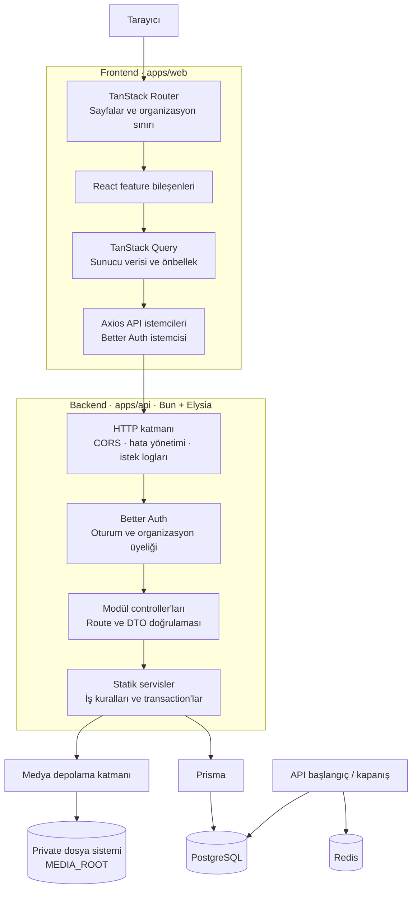
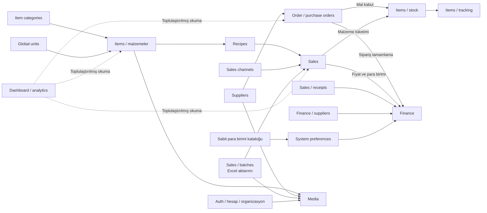
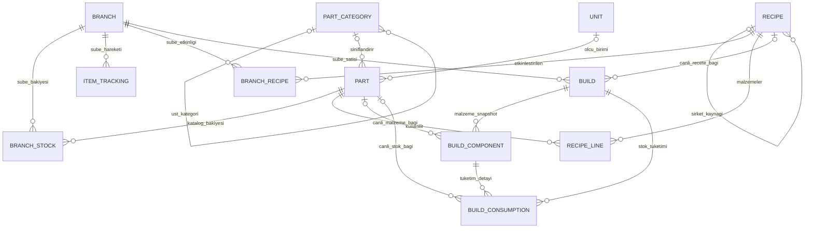
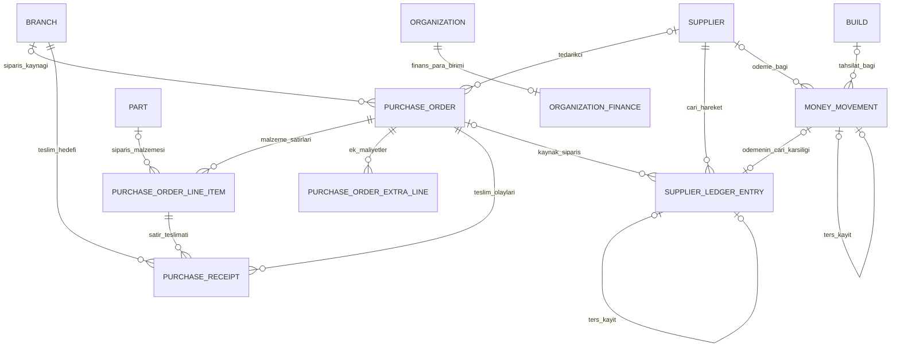

# Projenin mimari raporu

## Kapsam

Proje, organizasyon bazlı çalışan; malzeme, reçete, stok, satın alma, satış ve finans süreçlerini birleştiren bir ERP uygulamasıdır. Backend tarafında mikroservisler yerine tek API içinde ayrılmış modüller bulunur.

Bu rapor mevcut kaynak kod, Prisma şeması ve migration dosyalarından çıkarılmıştır. **“Veritabanında var” ifadeleri kaynakta tanımlı yapıları anlatır; canlı veritabanındaki tabloların ve uygulanmış migration’ların envanteri değildir.**

Diyagramlar Mermaid biçimindedir. Mermaid destekleyen bir Markdown görüntüleyicisinde çizim olarak görüntülenebilir.

---

## 1. Genel sistem mimarisi

### Kullanılan temel teknolojiler

| Katman | Mevcut teknoloji |
|---|---|
| Monorepo / paket yönetimi | Bun workspaces, Turborepo |
| Frontend | React 19, TypeScript, Vite |
| Yönlendirme / veri | TanStack Router, TanStack Query, Axios |
| Arayüz | Tailwind CSS, Radix tabanlı bileşenler |
| Dashboard düzenleyici | SnapGrid |
| Backend | Bun, Elysia **1.4.30** |
| Kimlik ve organizasyon | Better Auth **1.7.7** |
| Veritabanı erişimi | Prisma 7, PostgreSQL adapter |
| Veritabanı | PostgreSQL; geliştirme compose dosyasında PostgreSQL 17 |
| Dosya saklama | Private yerel dosya sistemi; metadata PostgreSQL’de |

**Redis ile ilgili önemli ayrım:** Mevcut kaynakta Redis bağlantısı ve başlangıç kontrolü vardır; ancak iş verisi cache’i, kuyruk, pub/sub veya session store olarak kullanıldığına rastlanmamıştır. API başlangıcı yine de Redis bağlantısının başarılı olmasını bekler.

Kaynaklar: [API bileşimi](../apps/api/src/app.ts#L27), [başlangıç akışı](../apps/api/src/index.ts#L42), [frontend başlangıcı](../apps/web/src/main.tsx#L19), [API bağımlılıkları](../apps/api/package.json#L21).

---

## 2. Backend modülleri nasıl bağlı?

Modüller HTTP üzerinden birbirleriyle konuşan ayrı servisler değildir. **Aynı süreç içinde birbirlerinin servis metotlarını çağırır ve gerektiğinde aynı veritabanı transaction’ını paylaşırlar.**

Oklar, servis veya veri bağımlılığını; kesikli oklar raporlama amaçlı okumayı gösterir.

### Modül envanteri

| Modül | Sorumluluğu | Alt modüller / önemli bağlantılar |
|---|---|---|
| `auth` | Giriş, oturum, native organizasyon ve takım altyapısı | Better Auth; `auth` ve `tenant` kontrolleri; `X-Branch-Id` çözümlemesi |
| `users` | Kullanıcı okuma, hesap yönetimi, üyelik ekleme ve rol değişikliği | Better Auth native API’leri, avatar medyası |
| `branches` | Şirket içindeki şubelerin kaynağı ve yaşam döngüsü | `BranchesService`: `X-Branch-Id` doğrulama, aktif şube kapısı, şube advisory kilidi |
| `dashboard` | Sistem/kişisel özetler, kişisel pano ve toplulaştırılmış analitik | `layout`, `analytics`; stok okumaları `branch_stock` üzerinden |
| `supplier` | Tedarikçi kayıtları | `images`; satın alma ve finans bağlantıları |
| `item-categories` | Hiyerarşik malzeme kategorileri | Kategori ağacı ve item bağlantıları |
| `items` | Şirket malzeme kataloğu ve şube stok bakiyeleri | `images`, `stock` (şube bakiyesi/minimum), `tracking` |
| `units` | Platform genelindeki ölçü birimleri; `divisible` yalnız metadata bayrağıdır (kg bölünebilir, adet bölünemez) ve miktar kuralı değiştirmez | Item’lar tarafından kullanılır |
| `currencies` | Sunucunun sabit ISO para birimi kataloğu | Ayrı Currency tablosu yoktur |
| `system-preferences` | Sistem varsayılan para birimi | Satın alma ve organizasyon finansı |
| `recipes` | Şirket reçete şablonları, şube etkinliği/uyarlaması, satılabilirlik bayrağı ve satış fiyatı | Items, units, finance, `BranchRecipe` |
| `order` | Şirket/şube kaynaklı satın alma, hedef şubeli mal kabul ve değişmez teslim olayları | `purchase-orders` → `lines`, `extra-lines`, `receive`, `receipts` |
| `sales` | Şubenin etkin reçetesiyle satış kaydı ve Excel partileri | `channels`, `receipts`, `batches` |
| `pos-devices` | Şube sahipli banka POS cihazları ve mutabakat Z raporları | `z-reports`; cihaz/parti şube eşitliği |
| `finance` | Şirket kapsamlı kasa hareketleri ve tedarikçi carisi | `suppliers`; satış tahsilatı ve satın alma borcu |
| `media` | Yükleme, dosya erişimi, bağlama ve silme yaşam döngüsü | Logo, avatar, item/tedarikçi görseli, satış Excel’i |

### Bir modülün iç yapısı

- **`controller.ts`:** HTTP route’u, doğrulama, kimlik/tenant gereksinimi ve durum kodları.
- **`service.ts`:** İş kuralları, veri erişimi ve transaction’lar.
- **`model.ts`:** DTO şemaları ve bunlardan türetilmiş tipler.
- **`formatter.ts`:** Gerektiğinde tarih, Decimal ve yanıt serileştirmesi.

Alt controller’lar üst modülde `.use(...)` ile birleştirilir; `app.ts` üst modülleri kaydeder.

Kaynaklar: [app.ts](../apps/api/src/app.ts#L48), [sales bileşimi](../apps/api/src/modules/sales/controller.ts#L9), [finance bileşimi](../apps/api/src/modules/finance/controller.ts#L7).

---

## 3. Veritabanında neler tanımlı?

Prisma şemasında **53 model ve 53 açık tablo eşlemesi** bulunur (`schema.prisma` içindeki `model`/`@@map` sayısı; canlı veritabanı envanteri değildir).

İsimlendirmede iki kritik nokta vardır:

- **`Part` / `part` = uygulamadaki Item, yani fiziksel malzeme.**
- **`Build` / `build` = uygulamadaki kaydedilmiş satış.**

Dolayısıyla `Build` ismi, ayrı bir üretim emri/BOM sistemi olduğu anlamına gelmez.

### Tam tablo envanteri

Aşağıdaki isimler fiziksel tablo adlarıdır.

| Alan | Tablolar | Saklanan veri |
|---|---|---|
| Kimlik ve oturum | `user`, `session`, `account`, `verification` | Hesap, giriş bilgileri, oturum ve doğrulama kayıtları |
| Organizasyon | `organization`, `branch`, `member`, `invitation`, `team`, `team_member` | Organizasyonlar, şirket içi şubeler, üyelikler, native roller, takımlar |
| Profil ve sorumluluk | `owner`, `user_profile` | İş sorumlusu metadata’sı ve organizasyon kapsamlı profil yapısı |
| Kişisel pano | `dashboard` | Kullanıcıya özel global/organizasyon pano düzeni; şube başına düzen yoktur |
| Global katalog/ayar | `model_type`, `unit`, `system_preference` | İçerik türleri, ölçü birimleri (`divisible` yalnız metadata), sistem varsayılanı |
| Malzeme ve stok | `part_category`, `part`, `branch_stock`, `item_tracking` | Kategori ağacı, paylaşılan malzeme kataloğu, şube+item bakiyesi/minimumu ve şube etiketli hareket geçmişi |
| Reçete | `recipe`, `recipe_line`, `branch_recipe` | Şirket şablonu, bir adet için malzeme miktarları, şube etkinliği ve şube-yerel/uyarlanmış tanım |
| Tedarik ve satın alma | `supplier`, `purchase_order`, `purchase_order_line_item`, `purchase_order_extra_line`, `purchase_receipt` | Tedarikçi, şirket/şube kaynaklı sipariş, malzeme/ek maliyet satırları ve hedef şubeli değişmez teslim olayları |
| Satış | `build`, `build_component`, `build_consumption` | Satış, satış anındaki malzeme görüntüsü ve stok tüketimi |
| Satış kanalı / Excel aktarımı | `sales_channel`, `sales_channel_mapping`, `sales_batch`, `sales_batch_channel`, `sales_product_mapping` | Kanallar, dosyalar ve dış verinin kanal/reçete eşlemeleri |
| Finans | `organization_finance`, `money_movement`, `supplier_ledger_entry` | Organizasyon para birimi, kasa hareketleri, tedarikçi carisi |
| Medya | `media_file` | Dosya metadata’sı, sahibi, bağlantısı ve yaşam döngüsü |
| Etiket ve seçim listeleri | `tag`, `tagged_item`, `selection_list`, `selection_list_entry` | Genel yardımcı yapılar |
| Not ve ekler | `note`, `notes_image`, `attachment` | Genel notlar, görseller ve dosya referansları |
| Bildirim / webhook | `notification_entry`, `notification_message`, `webhook_endpoint`, `webhook_message` | Bildirim ve webhook veri yapıları |

**Şema ile aktif özellik aynı şey değildir:** Kod taramasında `UserProfile`, `ModelType`, etiket/seçim listesi, not/ek, bildirim ve webhook modellerinin aktif API tüketicileri bulunmamıştır. Bunlar çalışan özellikler değil, **şemada bulunan fakat mevcut uygulama akışında kullanılmıyor görünen yapılar** olarak değerlendirilmelidir. Bu gözlem canlı DB’de kayıt bulunmadığı veya dış tüketici olmadığı anlamına gelmez. `Owner` ise satın alma sorumlusu çözümlemesinde kullanılır.

Kaynak: [Prisma şeması](../apps/api/prisma/schema.prisma#L18).

### Kimlik ve veri kapsamı

- Better Auth’un **9 native modeli** string kimlik kullanır.
- Kalan **44 model**, içeride integer `id`, dışarıya açılan kaynak kimliği olarak benzersiz `uuid` taşır.
- İş verisinin ana kapsamı `organizationId` alanıdır. Şube sahipli veri (şube stoğu, izleme, reçete uyarlaması/etkinliği, satış/parti/eşleme, POS, satın alma kaynağı, teslim hedefi) ayrıca aynı şirkete bağlı `branchId` taşır; şube kimliği HTTP'de yalnız UUID olarak görünür.
- `Branch` şirket içindeki bir konumdur; silinmez, `active` ile kapatılır ve geçmiş kimliği korunur. Şube kapsamı bir yetki/RBAC katmanı değildir.
- `Unit`, `SystemPreference`, `ModelType` globaldir.
- `Dashboard.organizationId = null`, kullanıcının global kişisel panosu anlamına gelir; şube filtresi bu düzeni çoğaltmaz.
- Medyada nullable organizasyon alanı; geçici yükleme, avatar ve silme yaşam döngüsünün bir parçasıdır.

---

## 4. Ana veritabanı ilişkileri

### 4.1 Malzeme, reçete ve satış

ER diyagramlarında daire, ilişkinin isteğe bağlı olabildiğini gösterir. Okunabilirlik için her tablonun organizasyon ve kullanıcı bağlantısı tekrarlanmamıştır. Gösterilen ilişkiler ana ilişkilerin bir alt kümesidir.

Bu yapının önemli sonuçları:

- **Stok bakiyesi Item/Part üzerinde değildir.** Her item'in bir şubedeki bakiyesi tek `BranchStock` satırında tutulur (`stock` `Decimal(20,5)`, `minimumStock` `Decimal(19,6)`, kendi iyimser `version`'ı); satır yoksa tam sıfır bakiye okunur ve okuma satır oluşturmaz. Item katalog sürümü bakiye sürümünden bağımsızdır.
- `ItemTracking` zorunlu `branchId` taşır; her bakiye yazımı aynı transaction'da şube etiketli hareket yazar.
- `RecipeLine.quantity`, **bir adet reçete satışı** için tüketilecek malzeme miktarıdır.
- Reçete şirket şablonudur: `branchId = null` şirket kaynağı, dolu değer şube-yerel/uyarlanmış tanımdır; `sourceRecipeId`/`sourceVersion` tam uyarlamanın kaynağını sabitler. `BranchRecipe` şube etkinliğini ayrı tutar (varsayılan kapalı); şirket etkinliği global kapıdır. Malzeme bazlı fark birleştirmesi yoktur; mevcut reçeteler kesimde başlangıç şubesine yerel olarak taşınır.
- `Recipe.code` nullable dış ürün kodudur (en fazla 100 karakter, çevresindeki boşluk atılır, boş değer null); baştaki sıfırlar korunur ve sayıya çevrilmez. Etkin tanım alanıdır: şirket düzenlemesi uyarlanmamış şubeleri izler, tam uyarlama kodu kopyalar ve kendi kodunu sabitleyebilir, sıfırlama şirket koduna döner. Benzersizlik kısıtı yoktur; aynı kod birden çok reçetede durabilir ve Excel satırı hedef şubede birden çok etkin eşleşme bulursa bloke edilir.
- `Recipe.sellable` (varsayılan `false`) doğrudan satış bayrağıdır ve etkinlikten/şube etkinliğinden bağımsızdır: etkin bir reçete satılabilir olmayabilir, iç içe malzeme reçeteleri ise satılabilir ya da fiyatlı olmak zorunda değildir. Satılabilir reçete fiyat ve para birimi taşır (sıfır geçerli fiyattır); yazma sonrası kalıcı birleşik durum fiyatsızsa istek `RECIPE_PRICE_REQUIRED` ile reddedilir. Oluşturmada atlanan değer `false`, güncellemede atlanan mevcut değeri korur, `sellable: false` kayıtlı fiyatı silmez; tam uyarlama değeri kopyalayıp kendi değerini sabitler, sıfırlama şirket köküne döner.
- Satış zorunlu şube taşır ve yalnız o şubenin etkin reçete grafiğini kullanır; doğrudan satılan kök reçete ayrıca `sellable` olmalıdır (`RECIPE_NOT_SELLABLE`), reçete adı, sürümü, fiyatı, etkin tanım provenance'ı (`recipeDefinitionUuid`, `recipeSourceVersion`) ve malzemeleri snapshot olarak kaydedilir.
- Canlı reçete veya malzeme bağlantısı silinse bile satışın kaydedilmiş isim/UUID/miktar bilgileri korunabilir.

**Örnek:** Bir reçete bir porsiyon için `0.200 kg` malzeme gerektiriyorsa, 3 adet satış hedef şubenin bakiyesinden toplam `0.600 kg` tüketir; aynı item başka şubede bağımsız bakiyedir.

Mevcut şemada depo, raf, lot, seri numarası veya ayrı son kullanma partisi modeli bulunmaz; şube bir stok sahibi konumdur, merkez depo/şubeler arası transfer modülü yoktur.

Kaynaklar: [malzeme ve stok](../apps/api/prisma/schema.prisma#L400), [reçete](../apps/api/prisma/schema.prisma#L600), [satış snapshot’ları](../apps/api/prisma/schema.prisma#L802).

### 4.2 Satın alma ve finans

Sipariş kaynağı `PurchaseOrder.branchId` ile şirket (`null`) veya tek şubedir; teslim hedefi ayrıdır ve her `PurchaseReceipt` satırı hedef şubeyi, miktarı ve fiyat/para birimi anlık görüntüsünü taşır. Teslim olayı değişmezdir; düzeltme ters kayıtla yapılır ve eski toplamlar fiyat/aktör/zaman uydurulmadan `legacyBaseline` işaretlenir.

Burada **iki ayrı finansal bakiye** vardır:

- **Kasa bakiyesi:** `MoneyMovement.amount` toplamı. Pozitif giriş, negatif çıkış.
- **Tedarikçi carisi:** `SupplierLedgerEntry.amount` toplamı. Pozitif borcu artırır; negatif ödeme/avans borcu azaltır.

Bakiye, sürekli güncellenen ayrı bir para alanı olarak değil, **kaydedilmiş hareketlerin toplamı** olarak hesaplanır. Finansal düzeltme, orijinal kaydı silmek yerine ters işaretli bağlı kayıtla yapılır.

Finans şirket kapsamındadır: kasa, borç ve para birimi şube başına bölünmez, hedef şubeli teslim olayları sipariş başına tek rezervasyon/tamamlama/ödeme yaşam döngüsünü çoğaltmaz. Hareket DTO'su bağlı belgenin kaynak şubesini (`branchUuid`/`branchName`) taşır; satış tahsilatı orijinal satış şubesini, satın alma satırı siparişin kaynak şubesini gösterir ve ters kayıt bu bağı korur.

**Satış `Receipt` tablosu yoktur:** Satış tahsilatı, satışa bağlı bir `MoneyMovement` kaydıdır. `PurchaseReceipt` finansal tahsilat değil, hedef şubeli fiziksel teslim olayıdır.

Kaynak: [finans modelleri](../apps/api/prisma/schema.prisma#L1121).

---

## 5. Temel iş akışları

### A. Satın alma

1. Tedarikçi seçilir; sipariş ve malzeme/ek maliyet satırları oluşturulur. Sipariş kaynağı şirket (`branchUuid: null`) veya bir şubedir ve operasyonel olduktan sonra değişmez.
2. Sipariş, teslim alınabilir duruma getirilir.
3. **Mal kabul**, teslim alınan miktarı artırır ve **hedef şubenin** malzeme stoğuna ekler.
   - Her satır hedef `branchUuid` taşır; şube kaynaklı siparişte varsayılan kaynak şube, şirket kaynaklı siparişte açık hedef gerekir. Tek satır birden çok şubeye kısmi teslim edilebilir.
   - Stok artışı, teslim miktarı × paket içi miktar üzerinden hesaplanır.
   - Stok, hareket geçmişi, sipariş satırının `received` değeri ve değişmez `PurchaseReceipt` olayı aynı transaction’da yazılır; istek anahtarı tekrarı engeller.
4. **Sipariş tamamlama**, gerekli fiyat/tedarikçi/para birimi kontrollerinden sonra tedarikçi borcunu kaydeder; hedef şubeler bu tek şirket finans yaşam döngüsünü çoğaltmaz.
5. **Tedarikçiye ödeme** ayrı işlemdir; aynı transaction’da kasa çıkışı ve cari borç azalması oluşturur.
6. **Teslim düzeltmesi** orijinali silmez: aynı satır/hedef şubeye bağlı tek ters kayıt yazılır; tüketilmiş veya negatife inecek bakiye reddedilir.

> **Mal kabul ≠ sipariş tamamlama ≠ ödeme.** Üçü farklı iş olayıdır.

Kaynaklar: [mal kabul](../apps/api/src/modules/order/purchase-orders/receive/service.ts#L12), [sipariş tamamlama](../apps/api/src/modules/order/purchase-orders/service.ts#L536).

### B. Satış

1. Şube bağlamı zorunludur (aktif şube); aktif satış kanalı, o şubede etkin ve `sellable` reçete ve adet seçilir. İç içe malzeme reçeteleri için satılabilirlik/fiyat aranmaz; bu kontrol yalnız doğrudan satılan kök reçeteye uygulanır.
2. Etkin reçete tanımı (şirket şablonu/uyarlama/yerel) o şube için çözülür; fiyat, para birimi, malzemeler ve **hedef şubenin** stok yeterliliği kontrol edilir. Satılabilir olmayan kök reçete `RECIPE_NOT_SELLABLE` ile reddedilir.
3. Satış, etkin tanım provenance'ı ve malzeme snapshot’ları oluşturulur.
4. Stok yalnız hedef şubeden düşülür; tüketim ve stok hareketleri aynı transaction’da kaydedilir.
5. Tahsilat daha sonra ayrı istekle yapılır; kalan tutarı aşamaz. Finans kaydı şirket defterindedir; istek şube bağlamı taşıyorsa satışın kendi şubesiyle eşleşmeyen tahsilat kapalıdır ve ters kayıt orijinal satış şubesini korur.

`requestKey`, aynı satış isteğinin tekrar gönderilmesinde ikinci kez stok düşülmesini önlemek için kullanılır.

> **Satış kaydı ≠ tahsilat.** Satış oluşturulması otomatik kasa girişi oluşturmaz.

Kaynaklar: [satış transaction’ı](../apps/api/src/modules/sales/service.ts#L419), [tahsilat](../apps/api/src/modules/finance/service.ts#L249).

### C. Excel’den toplu satış

- Dosya yüklenir ve taslak `SalesBatch` oluşur; parti yüklemede seçili şubeye sabitlenir ve taşınamaz.
- Sheet ve kolonlar seçilir.
- Kaynak kanal değerleri satış kanallarına eşlenir.
- Dolu ürün kodu satırı yalnız hedef şubenin etkin reçetesinin tam `code` değeriyle çözülür: karşılaştırma büyük/küçük harf duyarlıdır, baştaki sıfırlar korunur ve kayıtlı elle `code:` eşlemesi yedek ya da geçersiz kılma olarak kullanılmaz. Bir şirket reçetesi ile şube uyarlaması tek aday sayılır; uyarlama kodu değiştirdiyse eski kök kodu eşleşmez. Etkin eşleşme yoksa `PRODUCT_CODE_UNMATCHED`, birden çok etkin eşleşme varsa `PRODUCT_CODE_AMBIGUOUS` satırı bloke eder; kod tam eşleşmeyle bir etkin reçeteye çözülüp o reçete `sellable` değilse satır `PRODUCT_CODE_UNMATCHED` yerine `RECIPE_NOT_SELLABLE` ile bloke edilir; kodlu ürün için yeni elle eşleme reddedilir, yalnız eski kod eşlemesi temizlenebilir.
- Kodu boş satırlar mevcut tam `text:` elle eşlemesini kullanır; bulanık ad eşleştirmesi yoktur.
- Önizleme ve doğrulama, işleme ile aynı çözümleyiciyi ve aynı etkin reçete grafiğini kullanır.
- Önizlemenin tek bakiye okumasıyla bulunan toplam stok açığı, eksik item'a katkıda bulunan ve başka engeli olmayan her dahil satıra `STOCK_SHORTAGE` olarak yazılır ve bloklayan sorun sayısına eklenir; satır başına ayrı stok sorgusu yapılmaz, işleme aynı toplamı bağımsız stok kontrolüyle yeniden doğrular.
- İşleme sırasında tüm satırların toplam malzeme ihtiyacı hedef şube bakiyesine göre kontrol edilir; satışlar ortak satış çekirdeğiyle transaction içinde oluşturulur ve parti şubesini taşır.

Aynı dosyanın yeniden yüklenmesini otomatik engelleyen bir tekillik yoktur; her yükleme bağımsız batch olabilir.

**Geri alma sınırı:** İşlenmiş batch silinirken tüketilen stok **kaynak partinin şubesine** geri eklenir. Fakat batch satışlarından herhangi birinin tahsilat geçmişi varsa — tahsilat terslenmiş olsa bile — silme engellenir. Silinmiş bir malzeme nedeniyle stok iadesi yapılamıyorsa da işlem engellenir.

Kaynak: [batch geri alma](../apps/api/src/modules/sales/batches/service.ts#L898).

---

## 6. Organizasyon ve erişim sınırı

Sistemin ana güvenlik sınırı kayıt sahibi değil, **organizasyon üyeliğidir**.

- **`auth: true`:** Geçerli oturum ve aktif/banlı olmayan kullanıcı gerekir.
- **`tenant: true`:** Bunlara ek olarak aktif organizasyon ve güncel üyelik gerekir.
- Servislere `TenantActor = { userId, organizationId, branchId: number|null, branchUuid: string|null }` aktarılır; şube zorunlu yazımlarda `BranchesService.requireActor(db, actor, { active: true })` aynı transaction içinde `BranchActor` üretir ve şube yaşam döngüsü kilidini alır.
- İstemcinin gönderdiği `X-Organization-Id`, tenant seçmez; oturumdaki organizasyonla eşleştiğini doğrulamak için kullanılır.
- `X-Branch-Id` isteğe bağlıdır ve yalnız doğrulanmış organizasyon içinde çözülür: bozuk UUID 422, bilinmeyen/yabancı şirket UUID'si aynı 404, parametre yokluğu şirket bağlamıdır; sessiz varsayılan şube yoktur. Pasif şube okuma/geçmişte çözülür, operasyonel yazımlar transaction içinde reddedilir.
- Aynı organizasyonun üyeleri ortak iş kayıtlarını okuyup değiştirebilir. Şube seçimi bir yetki katmanı değildir; aynı şirketin üyesi seçili şubenin iş verisini görür.
- Native `owner/admin/member` rolleri organizasyonun üye/takım yönetimi içindir; ayrı ERP izin sistemi değildir.
- Platform `admin`, sistem yönetimi yetkisidir; organizasyon üyeliğinden ayrı değerlendirilir.
- `Owner` tablosu iş sorumlusu metadata’sıdır, erişim yetkisi değildir.

Davet tablosu mevcut olsa da **davet oluşturma/gönderme/yeniden gönderme ucu kapalıdır**; bunu çalışan e-posta daveti özelliği olarak değerlendirmemek gerekir. Diğer native davet uçları açık kalır.

Kaynaklar: [auth/tenant kontrolü](../apps/api/src/modules/auth/plugin.ts#L8), [Better Auth yapılandırması](../apps/api/src/modules/auth/auth.ts#L28).

---

## 7. Frontend’in organizasyonu

Frontend’de URL ve oturum bağlamı şu şekilde ayrılır:

| Katman | Yollar | Görevi |
|---|---|---|
| Oturum sınırı | `_authenticated` | Giriş kontrolü ve alt içeriğin açılması |
| Global sistem | `/`, `/organization` | Global kişisel pano ve organizasyon dizini; dizin `Actions` sütunu `Detaylar` ile şirket köküne, `Ayarlar` ile `/o/$organizationSlug/settings` adresine gider |
| Kişisel / sistem ayarları | `/settings`, `/settings/system/...` | Profil; admin için kullanıcı, birim ve para birimi yönetimi |
| Organizasyon sınırı | `/o/$organizationSlug` | Slug → üyelik → aktif organizasyon eşleşmesi |
| Şube sınırı | `/o/$organizationSlug/b/$branchUuid/...` | Şube UUID'sinin aynı şirkete ait olduğunun doğrulanması; şirket yolu şube seçilmemiş bağlamdır |
| Çalışma alanı | Organizasyon altında `supplier`, `stock`, `purchasing`, `sales`, `pos-devices`, `finance` | Günlük iş ekranları |
| Organizasyon ayarları | Organizasyon altında `settings/...` | Items, kategoriler, reçeteler, şubeler, detaylar, üyeler ve takımlar |

Organizasyon sınırı doğrulanmadan alt iş ekranları açılmaz. URL başka bir organizasyonu gösteriyorsa native aktif organizasyon değiştirilip belge yeniden yüklenir. Şube seçimi kanonik yol segmentidir: `/o/$organizationSlug/b/$branchUuid`. Şube sınırı ön yüklemesi yalnız bağlantı niyetinde çalışır ve şube okuması, tenant doğrulaması, etkin şube yayını veya istek iptali yapmaz; gerçek gezinme şubeyi mount öncesi doğrular ve seçim, router engelleri (kaydedilmemiş değişiklik diyaloğu dahil) geçtikten sonra yayınlanır. Şube segmenti doğrulanmış organizasyon sınırında `GET /branches/:branchUuid` ile çözülür; yabancı/bilinmeyen UUID `notFound()` ile kapanır, ilk şubeye geri dönüş yoktur ve şube segmentinin yokluğu şirket bağlamıdır. Arama parametresiyle şube seçimi yoktur. Şube bağlamı oturumun aktif organizasyonunu/team'ini değiştirmez.

Üç HTTP istemcisi bulunur:

- **`globalApi`:** Organizasyon ve şube header’ı eklemez (hesap/global istekler).
- **`api`:** İş isteklerini doğrulanmış organizasyona sabitler, yalnız `X-Organization-Id` gönderir; organizasyon değişirken istekleri durdurur.
- **`branchApi`:** Şube zorunlu isteklerde çağıranın açıkça verdiği `branchUuid` ile `X-Organization-Id` + `X-Branch-Id` gönderir, `branchUuid` olmadan çağrıyı reddeder ve şube geçiş sinyalini bağlar.

Route dosyaları incedir; sayfa ve API mantığı `features/<kaynak>` altında bulunur. Sunucu verisi TanStack Query’de tutulur. Şirket/şube bağlantıları `organization-navigation.ts` içindeki `organizationLocation(slug, branchUuid|null, target, params?)`, `organizationSectionTarget`, `useOrganizationScope` ve `useOrganizationResourceParams` ile üretilir; ayna rota parametreleri şirket-yalnız `getRouteApi` yerine bu erişimciden okunur. Şirket kataloğu sorgu anahtarları organizasyon kapsamlı kalır; şube verisi anahtarları `branchCacheScope(uuid|null)` (`<organizasyon>::<uuid|company>`) içerir. Şube mutasyonu, açılışta yakalanan şube kapsamını ve aynı şirketin tüm-şubeler toplamını (`<organizasyon>::company`) birlikte geçersiz kılar; toplam yakalanan organizasyon kapsamından türetilir, ortam seçicisinden değil. Şube seçici `catalog:branches.switcher` etiketleriyle şube yolunu (`/o/$organizationSlug/b/$branchUuid`) yazar; Company seçimi şube segmenti olmayan şirket yoluna gider. Şube ve şirket bağlamında çalışma alanı ve ayarlar kenar çubuğu `AppTitle` + `BranchSwitcher` taşır; hiçbir kapsamda organizasyon seçici/listesi çizilmez. Organizasyon bağlamı yalnızca doğrulanmış URL slug'ından gelir; şirket/şube ayarları iç gezinmesi yalnız o şirketin düz etiketini, `BranchSwitcher`'ı ve o şirketin ayar bağlantılarını gösterir, çapraz organizasyon üyelik listesi sorgulamaz; kişisel ve sistem ayarlarında organizasyon bölümü veya seçici yoktur. `stock`, `purchasing`, `sales`, `pos-devices` ve `settings/recipes` `Outlet` anahtarları aynı rota eşleşmesi içinde şube kapsamlı remount sağlar; pano, supplier, finance, item kataloğu ve şube yönetimi organizasyon anahtarını korur. `branchOutletKey` yalnız tek rota eşleşmesi remount ipucudur: şirket ve şube yolları ayrı rota eşleşmeleridir ve şube A→B yol parametresini değiştirdiğinden React anahtarı bileşen yerel durumunu veya kaydedilmemiş taslağı garanti etmez; kaydedilmemiş pano taslağı ekranın kendi gezinme onayıyla korunur. Şube segmenti olmayan şirket yolunda stok konumları, satışlar, satış partileri, POS cihazları/Z raporları ve reçete dizini organizasyonun tüm aynı-şirket kayıtlarını şube sahipliğiyle listeler; stok hareketi, satış/parti yükleme-işleme, POS cihazı/Z raporu, reçete etkinleştirme/özelleştirme ve satınalma gibi yazma işlemleri açık ve aktif bir şube yolu gerektirir.

**Dashboard düzeni kişisel, iş verisi ortaktır:** Kullanıcı kendi kart düzenini değiştirir; düzen kullanıcı+şirket sahipliğindedir, şube başına ayrı düzen yoktur ve şube yolu yalnız veri ucunu süzebilir. Bu, organizasyon kayıtlarına farklı erişim hakkı vermez.

Kaynaklar: [API istemcileri](../apps/web/src/lib/auth.ts#L77), [şube kapsamı](../apps/web/src/lib/branch-scope.ts), [şube sınırı](../apps/web/src/lib/branch-boundary.ts), [tipli yol hedefleri](../apps/web/src/lib/organization-navigation.ts), [şube rotası](../apps/web/src/routes/_authenticated/o/$organizationSlug/b/$branchUuid/route.tsx), [organizasyon sınırı](../apps/web/src/routes/_authenticated/o/$organizationSlug/route.tsx#L29), [güncel gezinme](../apps/web/src/components/layout/data/sidebar-data.ts#L70).

---

## 8. Mimariyi işletirken bilinmesi gerekenler

### Veri tutarlılığı yalnız Prisma şemasından ibaret değildir

Migration’larda ayrıca şunlar tanımlıdır:

- Negatif stok engeli (şube bakiyesi yazımlarında uygulama ve şema kontrolü).
- Organizasyonlar arası ilişki tutarlılığı için ek foreign key’ler; şube kapsamlı FK’ler aynı şirkete bağlıdır.
- Global kişisel dashboard için koşullu tekillik.
- Satın alma borcunun sipariş başına tekrar yazılmasını engelleyen koşullu indeks (hedef şubeli teslimler bunu çoğaltmaz).
- Finansal ters kayıt tekilliği ve değişmez teslim olayı/tek ters kayıt kısıtları.
- Şube kapsamı trigger/check’leri: reçete kaynak/uyarlama tutarlılığı, `PurchaseReceipt` değişmezliği ve ters kayıt eşleşmesi, operasyonel siparişte kaynak şube değişmezliği, `build.branch_id = sales_batch.branch_id`, satış parti eşlemesi reçetesinin şirket/aynı şube olması, raporu olan POS cihazının şube değişmezliği ve Z raporu partisinin cihaz şubesiyle eşitliği.
- Logo ve avatar dosyalarını native hesap/organizasyon yazmasına bağlayan trigger’lar.

Bu nedenle yalnız `schema.prisma` üzerinden çıkarılan bir ER diyagramı, bütün DB kurallarını göstermez. Bu kuralların migration dosyalarında bulunması, canlı DB’ye uygulanmış olduklarını tek başına kanıtlamaz.

### Yazmalar ortak kilitler kullanır

Şube yaşam döngüsü iki anahtarlı advisory lock ile korunur (`814209` + branchId): operasyonel yazımlar paylaşımlı, pasife alma/etkinleştirme özel modda ve **transaction'ın ilk kilidi** olarak alır. Kanonik sıra: şube yaşam döngüsü → sipariş `814206` → kategori `814202` → item `814203` → reçete `814204` → stok `814205` → finans `814207`; hiçbir transaction şube kilidini başka bir advisory lock'tan sonra almaz ve şube pasife alma başka advisory lock almaz. Şube kapatma, sıfır olmayan bakiye, açık şube kaynaklı sipariş, taslak satış partisi veya etkin POS cihazı varken 409 ile reddedilir; böylece kapanış uçuştaki yazımlarla yarışamaz.

Katalog, reçete, stok, satın alma ve finans için de sabit PostgreSQL advisory lock'ları vardır. Anahtarlar sabit olduğu için aynı alandaki bazı yazmalar **farklı organizasyonlarda da birbirini bekleyebilir**. Bu koddan görülen bir tasarım özelliğidir; ölçülmüş bir performans sorunu değildir. Dashboard/analitik yalnız okuma yapar ve bu kilitleri almaz.

### Dosyalar veritabanının dışındadır

`media_file` dosyanın kendisini değil, metadata’sını tutar. Binary içerik `MEDIA_ROOT` altındadır.

- Geçici → bağlı → siliniyor yaşam döngüsü vardır.
- PostgreSQL ve dosya sistemi arasında tek atomik transaction yoktur; bağlama ve ertelenmiş temizleme ile yönetilir.
- `media:cleanup` ayrı CLI işidir. API içinde otomatik zamanlayıcı kaydı yoktur.
- Yedekleme/taşıma planı **hem DB’yi hem medya dizinini** kapsamalıdır.

Kaynaklar: [kilit örneği](../apps/api/src/lib/catalog.ts#L76), [dosya depolama](../apps/api/src/lib/media.ts#L6), [temizleme işi](../apps/api/src/scripts/media-cleanup.ts#L5).

---

## 9. Sonuç ve inceleme sınırı

Projenin omurgası **şirket → şube → malzeme/reçete → şube stok hareketi → satın alma/satış → şirket finansal hareketi** zinciridir. Ortak katalog, şube stok ve şirket finans servisleri, farklı ekranların aynı tutarlılık kurallarıyla çalışmasını sağlar.

Bu yapı; **depo/lot bazlı envanter veya ayrı bir üretim sistemi değil**, reçete bazlı satışın hedef şubenin malzeme stoğunu tükettiği, satın almanın teslim hedefi şubeyi beslediği ve para hareketlerinin şirket düzeyinde ayrı kaydedildiği bir sistemdir. Şube bir yetki katmanı değil, stok ve operasyon kapsamıdır.

**İnceleme sınırı:** Rapor kaynak kod incelemesine dayanır. Test veya uygulama çalıştırılmamıştır. Canlı DB içeriği, migration uygulanma durumu ve üretim ortamındaki dosya/temizleme kurulumu doğrulanmamıştır. Rapor kaynak kodun anlık görünümünü anlatır; sonraki değişikliklerde ilgili kaynak bağlantıları ve satır numaraları güncelliğini yitirebilir.
